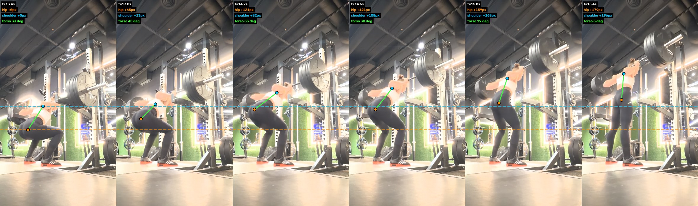
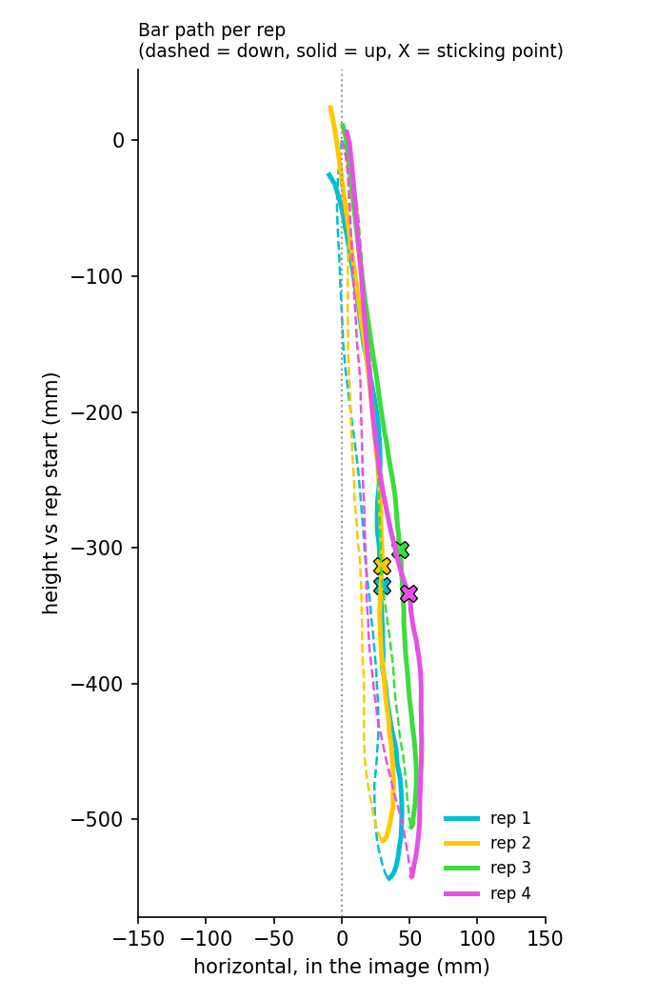

# lift-form-check

Measures barbell lifts from a phone video. Two scripts turn a squat video into numbers and overlays, so you can compare reps within a set and sets across sessions:

- **`tools/pose_guides.py`** detects hips and shoulders in each frame (YOLO11 pose model) and draws guide lines from each rep's bottom position. It measures how fast the hips and shoulders rise, torso lean compared with the bottom, and how much the hip–shoulder gap shrinks on the way up. This shows a "hips rise first" pattern in numbers.
- **`tools/bar_path.py`** tracks the hub of the near plate (OpenCV CSRT) and reports bar depth, descent and ascent speed, the sticking point and the bar path, in mm and m/s once the plate size is calibrated.



## Quick start

Needs macOS or Linux, Python 3.9–3.12 and about 1.5 GB of disk. [`uv`](https://docs.astral.sh/uv/) is optional and makes installs faster.

```bash
git clone https://github.com/JoanaSmit-dev/lift-form-check.git
cd lift-form-check
bash tools/setup.sh                       # venv, dependencies, model weights
bash results/2026-11-05-squat/run.sh      # re-run the example check
```

If your default `python3` is newer than 3.12, create the venv first with `uv venv --python 3.12 .venv`; `setup.sh` then uses it.

## Layout

Each form check is one self-contained folder under `results/`:

```
results/
└── 2026-11-05-squat/
    ├── IMG_0110.mov    the video
    ├── analysis.md     write-up
    ├── run.sh          exact commands and parameters for this video
    ├── frames/         stills picked for the write-up
    ├── guides/         pose_guides.py output
    └── bar/            bar_path.py output
```

Both tools write next to the video by default, so a new check is: make a folder, drop the video in, copy a `run.sh` and set its parameters. [SETUP.md](SETUP.md) walks through it, including how to read the rep bottoms off the timeline and how to pick the plate box.

## Example

[`results/2026-11-05-squat/analysis.md`](results/2026-11-05-squat/analysis.md) is a full write-up of a 4-rep high-bar back squat set. Over the set, ascent speed fell 27% (0.35 → 0.26 m/s), and the sticking point at about 40% of the way up slowed from 0.23 to 0.12 m/s. That sticking point lines up with peak torso lean in the pose data.



## Filming

- Keep the camera still (tripod or propped phone). The guides compare pixel heights between frames.
- Side-on at hip height, 3–4 m away, gives true torso angles. Other angles still work for comparing reps, but the angles are only 2D.

## Limits

- Angles and distances are measured in the 2D image, so they're best for comparing reps and sessions filmed the same way, not as absolute values.
- The pose tool follows the largest person in the frame, so someone walking close to the camera can throw it off.
- Speeds in m/s depend on a hand-measured plate size (about ±3%). Trust rep-to-rep trends more than single values.

More detail, options and troubleshooting are in [SETUP.md](SETUP.md).
