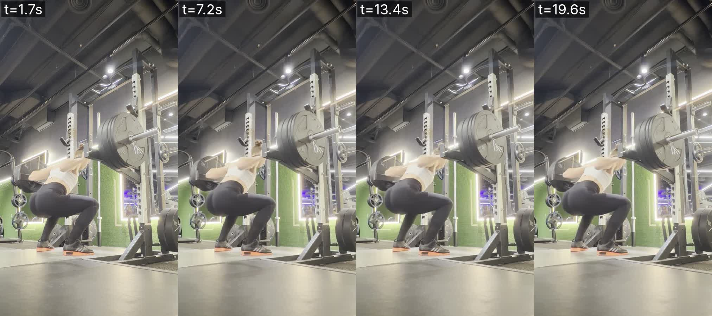
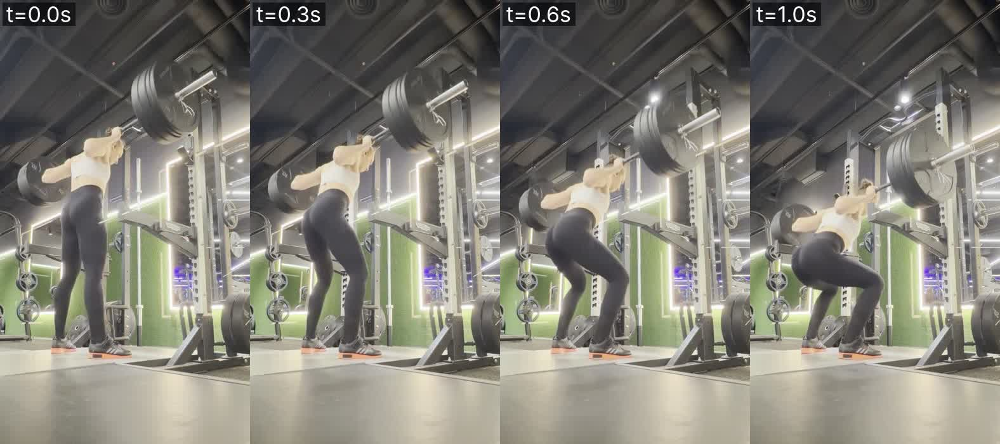
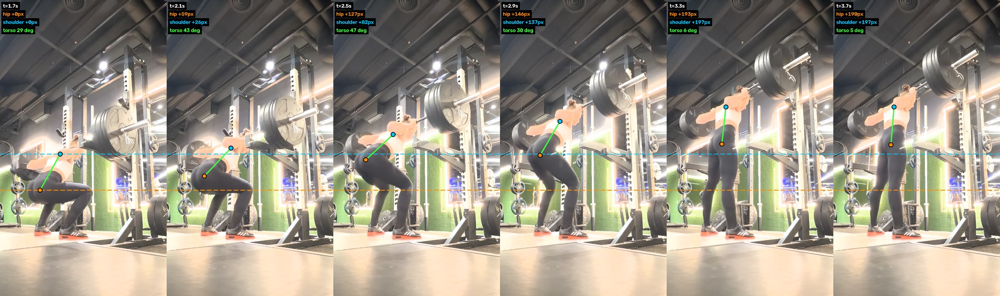
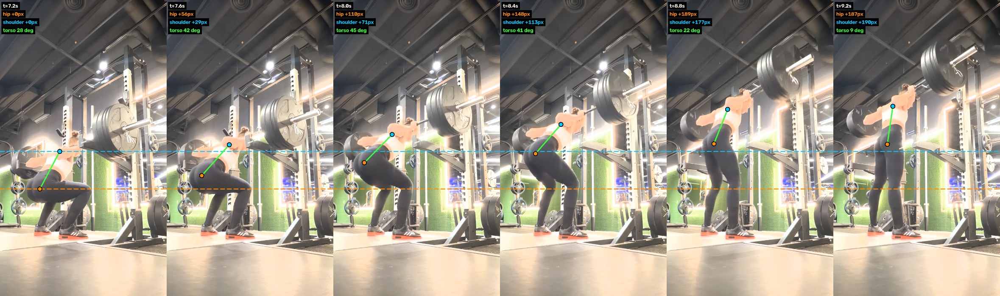
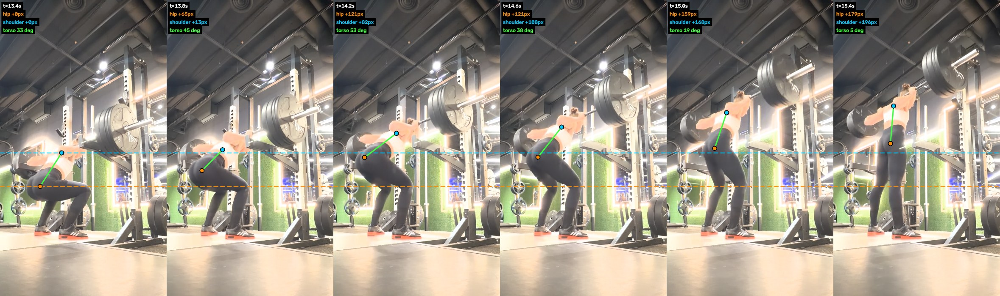
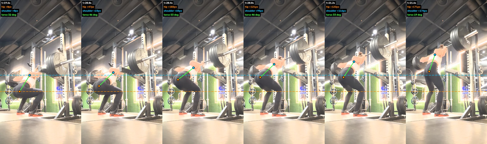
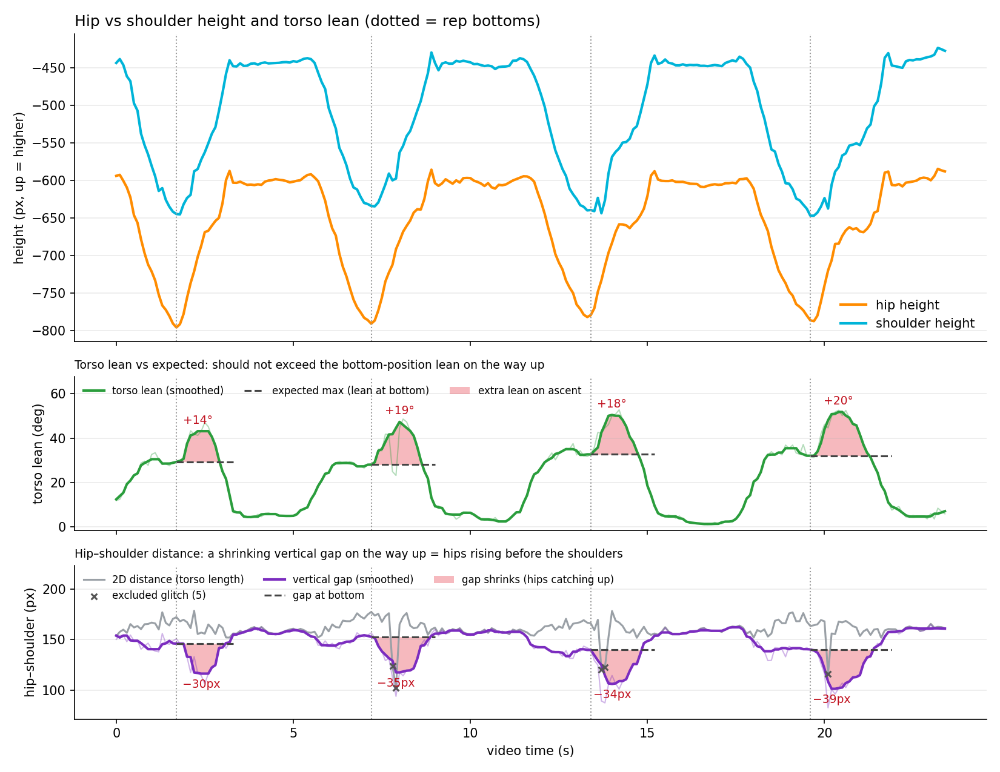
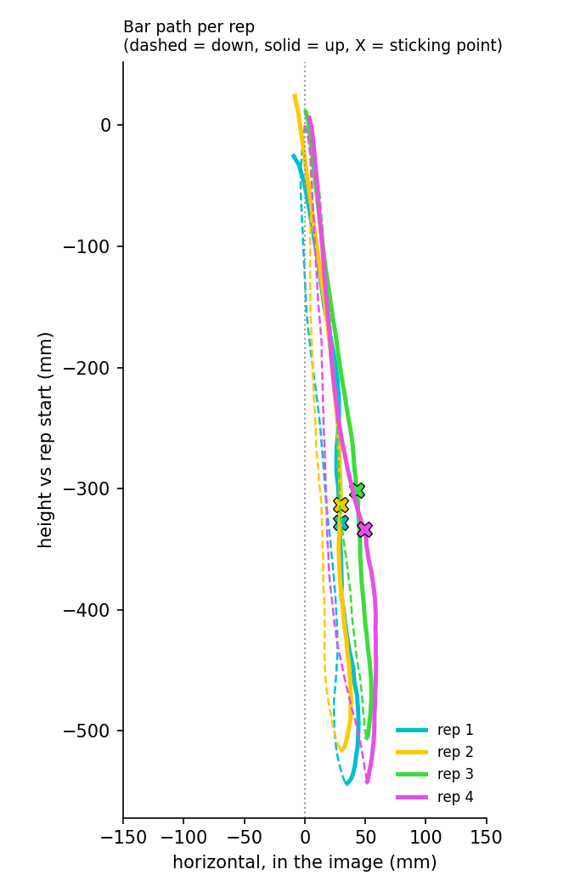
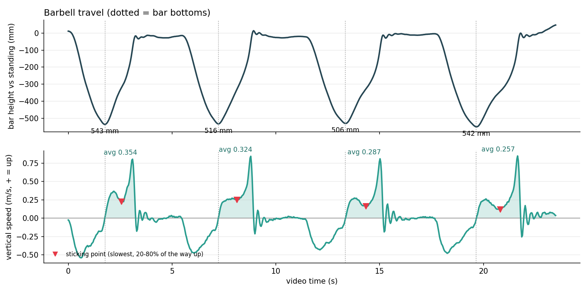

# Squat Form Analysis — IMG_0110.mov

**Date:** 2026-11-05
**Lift:** High-bar back squat, 4 reps, weightlifting shoes
**Video:** `videos/IMG_0110.mov` 23.5 s, filmed low from behind and off to one side (rear three-quarter)

> Note: this angle hides some details. Knee tracking and hip shift can't be judged reliably from it, and the torso angles below are measured in the 2D image, not as your true side-on angle. They're good for comparing reps and frames with each other, not as absolute numbers.

## Rep timeline (measured with pose detection)

| Rep | Descent starts | Bottom (lowest hip) | Standing again |
|-----|----------------|---------------------|----------------|
| 1   | ~0.0 s | **1.7 s**  | ~3.3 s  |
| 2   | ~5.6 s | **7.2 s**  | ~9.0 s  |
| 3   | ~11.8 s| **13.4 s** | ~15.4 s |
| 4   | ~18.0 s| **19.6 s** | ~21.8 s |

## Files

**Frame sheets** (`frames/`)
- `overview-1.jpg`, `overview-2.jpg`, `overview-3.jpg`: one frame per second, timestamped (0–7 s, 8–15 s, 16–23 s)
- `bottom-positions.jpg`: the true bottom of each rep (1.7 / 7.2 / 13.4 / 19.6 s)
- `rep1-descent.jpg`: first descent (0.0 / 0.3 / 0.6 / 1.0 s)
- `rep1-ascent.jpg` … `rep4-ascent.jpg`: plain ascent strips from the first pass. ⚠ These start 0.4–0.7 s before the true bottom, so use the guide versions below.

**Guide overlays** (`frames/guides/`)
- `rep1-ascent-guides.jpg` … `rep4-ascent-guides.jpg`: from the true bottom to +2 s, every 0.4 s. In each frame:
  - 🟠 orange dashed line = **hip** height at the bottom
  - 🔵 cyan dashed line = **shoulder** height at the bottom
  - green line = torso (shoulder midpoint → hip midpoint), with its lean from vertical
  - labels show how far the hips and shoulders have risen since the bottom
- `hip-shoulder-timeline.png`: hip and shoulder height and torso lean across the whole video, with each ascent's lean compared to the expected maximum (red = extra lean)
- `lean-vs-bottom.csv`: per rep, lean at the bottom, peak lean on the ascent, and the extra
- `gap-vs-bottom.csv`: per rep, the vertical hip–shoulder gap at the bottom and how much it shrinks on the ascent
- `ascent-measurements.csv`: the numbers behind the strips; `poses-IMG_0110.json`: raw detections (cache)

**Barbell travel** (`frames/bar/`)
- `bar-path-chart.png`: each rep's bar path, horizontal vs vertical at the same scale, in mm
- `bar-path.jpg`: the same paths drawn on a video frame
- `bar-timeline.png`: bar height and vertical speed across the whole set
- `bar-reps.csv`: per-rep depth, timing, speeds, sticking point and drift; `bar-track.csv`: per-frame values

**Tools**
- `tools/pose_guides.py`: body landmarks, guide overlays, lean and gap
- `tools/bar_path.py`: barbell tracking
- See [SETUP.md](SETUP.md).

## What looks good

- **Feet:** heels stay down in every rep, and the lifters let the knees travel forward. *See `bottom-positions.jpg`.*
- **Bar and upper back:** the bar stays put on the back and the elbows stay under it through all reps. *See `overview-1/2/3.jpg`.*
- **Bottom position:** depth and torso angle at the bottom are very consistent (28–33° lean on all four reps). *See `bottom-positions.jpg`; `hip-shoulder-timeline.png`.*
- **Lower back:** no visible rounding at the bottom of any rep. *See `bottom-positions.jpg`.*



## What to check

### 1. Depth: about parallel
At the true bottom, the hip crease looks level with the top of the knee or slightly below it, on all four reps. That's deeper than my first estimate, which used frames taken before the real bottom. Side-view footage would confirm it.
*Frames: `bottom-positions.jpg` (1.7 / 7.2 / 13.4 / 19.6 s).*

### 2. Descent leads with the hips
In the first ~0.3 s of each descent, the hips push back while the knees are only slightly bent, and the torso lean climbs steadily on the way down (`hip-shoulder-timeline.png`, lower panel). For a high-bar squat in lifters, break at the hips and knees together and sit *down* between the heels.
*Frames: `rep1-descent.jpg` (0.3 s, 0.6 s); `overview-3.jpg` (18 s).*



### 3. Hips rise first on every rep, and more on the later reps
Right out of the bottom, the hips rise about **twice as fast as the shoulders** on every rep. The torso tips forward 15–20° beyond the bottom position, then straightens near the top.

| Rep | Bottom | Lean at bottom | Hip vs shoulder rise, first 0.4 s | Peak lean (time) | Hip stall |
|-----|--------|----------------|------------------------------------|------------------|-----------|
| 1 | 1.7 s  | 29° | 59 vs 26 px | 47° (2.5 s)  | none |
| 2 | 7.2 s  | 28° | 56 vs 29 px | 45° (8.0 s)  | none |
| 3 | 13.4 s | 33° | **65 vs 13 px** | **53° (14.2 s)** | **14.2 → 14.6 s** (hips flat, shoulders catch up) |
| 4 | 19.6 s | 32° | 47 vs 23 px | **53° (20.4 s)** | **20.8 → 21.2 s** |

What this shows:
- **All four reps** have the pattern, so it's technique, not just fatigue.
- **It gets worse on reps 3–4.** Peak lean goes up from ~46° to 53°, and there's a clear **sticking point** where the hips stop rising while the shoulders catch up. You can see it as the flat spot in the orange line on `hip-shoulder-timeline.png` around 14.4 s and 21.0 s.
- My first by-eye pass got two things wrong: rep 2 isn't the worst rep, and the hips don't rise together with the shoulders at first. These measurements replace that version.

**Lean compared with the expected maximum** (`hip-shoulder-timeline.png`, lower panel; `lean-vs-bottom.csv`). On the way up, the torso shouldn't lean further forward than it did at the bottom. It should hold that angle or get more upright. The dashed line marks each rep's bottom lean, and the red area is lean beyond it. These figures come from the 10 fps timeline, smoothed, with glitch frames left out (see below), so they differ by a degree or two from the 0.4 s strips in the table.

| Rep | Lean at bottom | Peak on ascent | Extra |
|-----|----------------|----------------|-------|
| 1 | 29° | 43° (2.3 s)  | **+14°** |
| 2 | 28° | 47° (8.0 s)  | **+19°** |
| 3 | 33° | 50° (14.0 s) | **+18°** |
| 4 | 32° | 52° (20.4 s) | **+20°** |

Every rep goes 14–20° past its bottom angle. The extra lean is similar from rep to rep, but reps 3–4 start from a more inclined bottom, so they reach the highest absolute lean. A good goal for the next session is to shrink the red areas.

**Hip–shoulder distance** (`hip-shoulder-timeline.png`, bottom panel; `gap-vs-bottom.csv`). The purple line is the vertical gap, meaning how far the shoulders sit above the hips. When the hips rise faster than the shoulders, the gap shrinks below its value at the bottom (dashed line, red area). The grey line is the straight-line distance between them: the torso length as it appears on screen, which should stay roughly flat.

| Rep | Gap at bottom | Smallest gap on ascent | Shrink |
|-----|---------------|------------------------|--------|
| 1 | 146 px | 116 px (2.4 s)  | −30 px (20%) |
| 2 | 153 px | 118 px (7.9 s)  | −35 px (23%) |
| 3 | 140 px | 106 px (14.0 s) | −34 px (24%) |
| 4 | 140 px | 101 px (20.2 s) | **−39 px (28%)** |

The gap shrinks by a fifth to over a quarter on every ascent, most on rep 4. This is a second view of the same movement as the lean panel, not independent evidence: when the torso length stays constant, the vertical gap is about torso length × cos(lean). Shown this way, though, it reads directly as "hips catching up to shoulders".

**Glitch frames.** The torso length on screen should stay about the same, so frames where it jumps more than 15% from its median are treated as detection errors. They're marked × (5 frames, around 7.9 s, 13.8 s and 20.1 s) and left out of the smoothed lean and gap values. Without this filter, the gap shrink was overstated (rep 3 read as −51 px instead of −34 px), and so was the rep 1 lean (+16° instead of +14°).

Caveats: some forward lean on the way up is normal, and the 2D angles from this camera position aren't true side-on angles.

If it holds up in a side view, here's what usually helps:
- **Pause squats:** 2 s at the bottom, then drive up with chest and hips together.
- **Tempo squats:** slow descent, controlled ascent.
- **Cue:** "push your upper back into the bar" coming out of the bottom.
- **For the sticking point on later reps:** pin squats or 1¼ reps set at the stall height, and check whether the load is too heavy for clean reps 3–4.

**Rep 1**: `frames/guides/rep1-ascent-guides.jpg`


**Rep 2**: `frames/guides/rep2-ascent-guides.jpg`


**Rep 3** (biggest lean, sticking point): `frames/guides/rep3-ascent-guides.jpg`


**Rep 4** (big lean, sticking point): `frames/guides/rep4-ascent-guides.jpg`


**Whole set**: `frames/guides/hip-shoulder-timeline.png`


## Barbell travel

**How it's measured.** `tools/bar_path.py` follows the hub of the plate nearest the camera, where the sleeve meets the plate with the collar and clip, through every frame (OpenCV CSRT tracker, 30 fps). I checked by eye that the tracked point stays on the hub in the standing frames and at all four bottoms. To convert pixels to mm, it uses the plate's known 450 mm diameter. The plate measures about 220 px on screen when you're standing and about 250 px at the bottom, because it's closer to the camera there, so the scale is interpolated with bar height.

| Rep | Depth | Descent duration | Avg speed down | Ascent duration | Avg speed up | Sticking point | Speed there | Side drift |
|-----|-------|------------------|----------------|-----------------|--------------|----------------|-------------|------------|
| 1 | 543 mm | 1.70 s | 0.32 m/s | 1.47 s | **0.35 m/s** | 2.56 s (42% up) | 0.23 m/s | 54 mm |
| 2 | 516 mm | 1.70 s | 0.30 m/s | 1.67 s | **0.32 m/s** | 8.13 s (37% up) | 0.25 m/s | 46 mm |
| 3 | 506 mm | 1.86 s | 0.27 m/s | 1.80 s | **0.29 m/s** | 14.35 s (40% up) | 0.16 m/s | 55 mm |
| 4 | 542 mm | 1.90 s | 0.29 m/s | 2.13 s | **0.26 m/s** | 20.81 s (38% up) | 0.12 m/s | 59 mm |

*Avg speed down = bar travel ÷ descent time. Avg speed up = bar rise ÷ ascent time. Sticking point = the slowest moment between 20% and 80% of the way up. Side drift = horizontal range on screen during the rep.*

What this shows:
- **Depth is consistent:** 506–543 mm of bar travel, within about ±4%, which fits the about-parallel bottoms in section 1.
- **The descent is controlled:** 1.7–1.9 s on every rep, at 0.27–0.32 m/s on average, slowing a little on reps 3–4. On reps 1–3 you come up slightly faster than you go down. On rep 4 it flips: the ascent (0.26 m/s) is slower than the descent (0.29 m/s).
- **Ascent speed drops 27% across the set** (0.35 → 0.26 m/s), and the ascent takes 45% longer (1.47 → 2.13 s). In velocity-based training, a 20–30% speed loss within a set is usually read as a set that ended fairly close to failure. Whether that's what you intended depends on your programming.
- **Every ascent has the same three phases:**
  1. a quick drive out of the bottom, about 0.25–0.3 m/s
  2. a slow section at about 40% of the way up, roughly 200–215 mm above the bottom
  3. a fast finish, peaking around 0.8 m/s near the top
- **The slow section gets much slower with each rep:** 0.23 → 0.12 m/s, about half the speed by rep 4. This is the sticking point.
- **The sticking point matches the body measurements.** The bar is slowest just after your torso reaches its maximum forward lean (lean peaks at 2.3 / 8.0 / 14.0 / 20.4 s, bar slowest at 2.56 / 8.13 / 14.35 / 20.81 s). On reps 3–4, it falls inside the hip stall from section 3 (14.2–14.6 s and 20.8–21.2 s). The bar and the body were measured independently, and both point to the same place: the hips have already risen, the torso is most inclined, and the lift has to change over from leg drive to hip extension.
- **The fast finish** is mostly your torso swinging back upright, which lifts the bar quickly. It's part of the hips-first pattern, not extra leg drive.
- **The bar path is near-vertical and repeatable:** 46–59 mm of side-to-side movement on screen, slightly the widest on rep 4. From this angle, forward/back and sideways movement can't be separated, so I can't tell whether the bar drifts forward over your toes during the hips-first phase. A side view would show that.





**How accurate this is:**
- **Scale:** I measured the plate size by hand to about ±5 px, so mm and m/s values are good to about ±3% from that alone.
- **Camera tilt:** the camera points upward from low down, so "vertical" on screen isn't exactly vertical.
- **Repeatability:** running the same tracker on two machines gave average speeds within 0.01 m/s of each other, but sticking-point speeds differed by up to 0.05 m/s. So trust the trends (rep-to-rep changes) more than single values.
- **Comparing to other sessions:** absolute speeds can only be compared with other sessions if the camera setup and plate calibration are the same.

## Filming tips for next time

- **Side view:** phone at hip height, straight side-on, about 3–4 m away, on a static mount. This gives true torso angles and depth, and the guide tool works best with a camera that doesn't move.
- **Straight from behind:** shows whether the knees cave in or the hips shift to one side.

## Next steps

- [ ] Film a side-view set and run `pose_guides.py` on it (see [SETUP.md](SETUP.md))
- [ ] Practice breaking at the hips and knees together on warm-up sets (tempo squats help)
- [ ] Add pause squats; cue "push your upper back into the bar"
- [ ] Track average ascent speed per rep (`bar-reps.csv`): this set lost 27% from rep 1 to 4, and the sticking-point speed halved
- [ ] Watch reps 3–4: compare the extra lean vs bottom (now +14–20°; target under ~10°), the gap shrink (now 20–28%), and whether the hip stall goes away

## Re-running the tool

Setup, usage and options are in [SETUP.md](SETUP.md). To regenerate this analysis:

```bash
cd ~/form-check
bash tools/setup.sh          # first time only
.venv/bin/python tools/pose_guides.py videos/IMG_0110.mov --reps 1.7,7.2,13.4,19.6 --fps 10
.venv/bin/python tools/bar_path.py videos/IMG_0110.mov --box-t 4.0 --box 465,225,100,105 --plate-cal 4.0:220,13.4:250
```

## Changes log

- **v1 → v2:** Removed the "rack-out" point (the 0 s frame is rep 1's descent).
- **v2 → v3:** Added per-rep ascent strips and the hips-rise-first table (by eye).
- **v3 → v4 (measured):** Bottom times corrected (1.0/6.8/13.0/19.2 s → 1.7/7.2/13.4/19.6 s), depth revised to about parallel, and the by-eye hips-first table replaced with pose measurements. Rep 2 isn't the worst rep; reps 3–4 are, with a sticking point.
- **v4 → v5:** Moved to `training-log/form-check/Claude`, added `SETUP.md`, `tools/setup.sh` and `.gitignore`, and renamed the detection cache to `poses-IMG_0110.json`.
- **v5 → v6:** Added the expected-lean comparison (bottom lean as the maximum, extra lean shaded) to the timeline, plus `lean-vs-bottom.csv`.
- **v6 → v7:** Added the hip–shoulder distance panel and `gap-vs-bottom.csv`. Glitch frames are now filtered by torso length, and the lean numbers were updated slightly as a result (+14/19/18/20°).
- **v7 → v8:** Added the Barbell travel section (`tools/bar_path.py`, `frames/bar/`): plate-hub tracking, depth, ascent speed, sticking point and bar path.
- **v8 → v9:** Added average descent speed to `bar-reps.csv` and the Barbell travel table, and renamed the Down/Up columns to Descent/Ascent duration.
- **v9 → v10:** Split out of the `training-log` repo into a standalone repo. The video now lives in `videos/`, and all commands run from the repo root.
